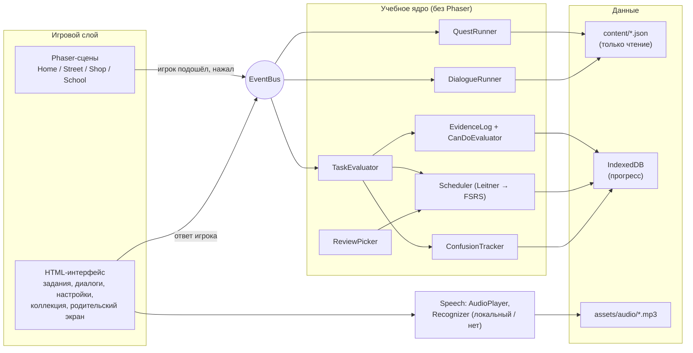
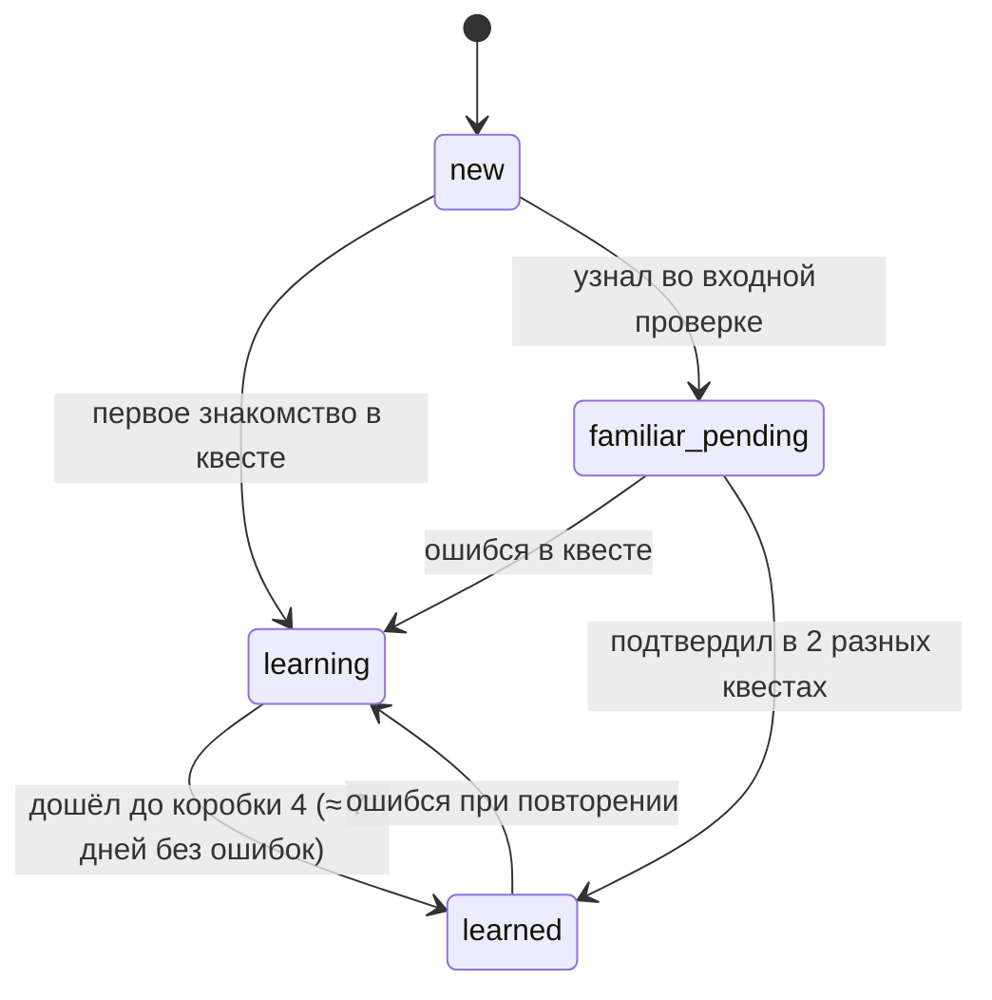

# Архитектура — English Adventure: Little Town (MVP)

Статус: **Этап 0, на согласовании.** Код игры ещё не написан.

---

## 1. Главный принцип

Игра делится на два слоя, которые почти не знают друг о друге:

1. **Учебное ядро** (`src/learning`, `src/content`, `src/storage`) — чистый TypeScript, **без Phaser и без DOM**. Решает, какое слово показать, засчитать ли ответ, подтверждён ли навык. Полностью покрывается автотестами.
2. **Игровой слой** (`src/game`, `src/ui`) — Phaser-сцены и HTML-интерфейс. Только показывает мир и передаёт действия игрока в ядро.

Связь между ними — через **шину событий** и несколько узких интерфейсов.
Так учебную логику можно проверять тестами без запуска игры, а позже — перенести в другую оболочку (например 3D) без переписывания.



---

## 2. Структура каталогов

```
english-adventure/
├── MASTER_PROMPT_MVP.md        # задание на MVP (источник правды)
├── README.md
├── docs/
│   ├── ARCHITECTURE.md         # этот файл
│   ├── DATA_SCHEMAS.md         # описание форматов данных
│   ├── RISKS.md
│   ├── DECISIONS.md            # журнал принятых решений
│   └── BACKLOG.md              # идеи «после MVP»
├── schemas/                    # JSON Schema — контракт для контента и сохранений
│   ├── common.schema.json
│   ├── vocabulary.schema.json
│   ├── phrases.schema.json
│   ├── items.schema.json
│   ├── npcs.schema.json
│   ├── dialogue.schema.json
│   ├── quest.schema.json
│   ├── can_do.schema.json
│   └── save.schema.json        # формат экспорта прогресса
├── content/                    # учебный контент, правится без программиста
│   ├── vocabulary.json
│   ├── phrases.json
│   ├── can_do.json
│   ├── items.json
│   ├── npcs.json
│   ├── quests/q.home.blue_cup.json …
│   └── dialogues/d.home.mum_blue_cup.json …
├── assets/
│   ├── LICENSES.md             # лицензия каждого пакета графики/звука
│   ├── tiles/ sprites/ ui/ images/words/
│   └── audio/
│       ├── us_f/ us_m/ uk_f/ uk_m/   # <id>.mp3, <id>.slow.mp3
│       └── ru/                        # озвученные русские подсказки
├── tools/                      # скрипты разработки (Node)
│   ├── validate-content.mjs    # проверка контента (уже есть, этап 0)
│   ├── generate-audio.mjs      # TTS при сборке (этап 2–3)
│   └── gen-types.mjs           # TS-типы из JSON Schema
├── src/
│   ├── main.ts                 # точка входа: загрузка, запуск Phaser
│   ├── core/                   # EventBus, Clock (подменяемое время для тестов), конфиг
│   ├── content/                # ContentRegistry: загрузка и индексы контента
│   ├── learning/               # учебное ядро (см. раздел 3)
│   ├── quests/                 # QuestRunner и обработчики шагов
│   ├── dialogue/               # DialogueRunner
│   ├── speech/                 # AudioPlayer, Recognizer, сопоставление ответа
│   ├── storage/                # IndexedDB, репозитории, экспорт/импорт, миграции
│   ├── game/                   # Phaser: сцены, герой, спутник, NPC, предметы, ввод
│   ├── ui/                     # HTML-панели поверх canvas
│   └── parent/                 # отчёты для родителя
├── tests/                      # node:test сейчас (инструменты), vitest с этапа 1
├── public/                     # manifest.webmanifest, иконки
└── vite.config.ts
```

Правило: **одна папка — одна ответственность**, файл не длиннее ~300 строк.

---

## 3. Учебное ядро

| Модуль | Что делает | Зависит от |
|---|---|---|
| `ContentRegistry` | загружает `content/*.json`, строит индексы по id, отдаёт слова/фразы/квесты | — |
| `Scheduler` (интерфейс) | хранит «коробку» и дату следующего показа для каждого слова/фразы; `LeitnerScheduler` — первая реализация (1→2→4→7→14 дней) | `Clock` |
| `TaskEvaluator` | проверяет ответ на задание (выбор, сборка, голос, ввод слова), учитывает допуски | `AnswerMatcher` |
| `EvidenceLog` | пишет каждое учебное событие (что, где, верно ли, голосом ли, когда) | `storage` |
| `CanDoEvaluator` | по правилам из `can_do.json` и журналу решает: не начато / в процессе / подтверждено | `EvidenceLog` |
| `ConfusionTracker` | считает пары путаницы (`w.blue ↔ w.green`) | `EvidenceLog` |
| `ReviewPicker` | выбирает, какое слово повторить сейчас (с учётом срока, путаницы, доли повторения ≤ 30% сессии, текущей локации) | `Scheduler`, `ConfusionTracker`, `ContentRegistry` |
| `PlacementCheck` | входная проверка: помечает слова «знакомо, нужно подтверждение» | `Scheduler` |
| `ModeSelector` | выбирает режим ответа (послушай-выбери / собери / скажи / напиши) по «зрелости» слова и возрастному режиму | `Scheduler`, настройки |

Время всегда берётся из `Clock`, а не из `Date.now()` напрямую — это позволяет в тестах «перематывать» дни и проверять повторение.

### Жизненный цикл слова



Статус `learned` открывает карточку в коллекции.

### Выбор режима ответа

| Состояние слова | Младший режим | Старший режим |
|---|---|---|
| новое / коробка 0–1 | послушай и выбери | послушай и выбери |
| коробка 2 | собери фразу / выбери | собери фразу |
| коробка 3+ | скажи вслух (если микрофон включён), иначе выбери | скажи вслух или напиши слово |

---

## 4. Квесты и диалоги

- **Квест** — список шагов. Типы шагов: `dialogue`, `find_item`, `give_item`, `go_to`, `task`, `review_slot`.
- **Диалог** — граф реплик. Реплика NPC может содержать **задание** (`task`); ветка выбирается по результату (`on_correct` / `on_wrong` / `on_skip`).
- Квест не может «застрять»: у каждого задания после 2 неудачных попыток — подсказка спутника, после 3-й — правильный ответ звучит, ребёнок повторяет и идёт дальше (событие пишется как «с подсказкой», в подтверждение навыка не засчитывается).
- `review_slot` — место в квесте, куда `ReviewPicker` подставляет слово на повторение (например, «по дороге спутник замечает предмет»).

Формат — см. `DATA_SCHEMAS.md`.

---

## 5. Хранение прогресса (IndexedDB)

База `english-adventure`, версия схемы хранится в `meta.schemaVersion`.

| Хранилище | Ключ | Содержимое |
|---|---|---|
| `profile` | `"main"` | имя, аватар, возрастной режим, настройки, лимит времени |
| `items` | id слова/фразы | статус, коробка, дата следующего показа, счётчики |
| `events` | автоинкремент | журнал учебных событий (кольцевой буфер, последние 20 000) |
| `quests` | id квеста | статус, текущий шаг, полученные награды |
| `world` | `"main"` | текущая локация, позиция героя, украшения комнаты |
| `canDo` | id навыка | статус и дата подтверждения (кэш — пересчитывается из журнала) |
| `playtime` | дата `YYYY-MM-DD` | секунды игры за день |
| `meta` | ключ | версия схемы, дата установки, результат входной проверки |

- Сохранение — после каждого учебного события и при смене локации; позиция героя — не чаще раза в 5 секунд.
- **Экспорт** — один JSON-файл по `schemas/save.schema.json`; **импорт** проверяет схему и версию, при несовпадении — миграции из `src/storage/migrations/`.
- Один профиль на устройство в MVP. Структура не мешает позже добавить несколько.

---

## 6. Звук и речь

- `AudioPlayer`: проигрывает `assets/audio/<акцент>_<пол>/<id>.mp3`: акцент (US/UK) выбирает игрок, пол голоса задан у каждого NPC, для заданий и спутника — «голос рассказчика» из настроек; кнопка «медленно» — файл `<id>.slow.mp3`, если нет — `playbackRate = 0.75`.
- Аудио предзагружается по локации (не всё сразу).
- `Recognizer` — интерфейс с реализациями:
  - `NullRecognizer` — микрофон выключен/недоступен: «скажи вслух» заменяется на «послушай и выбери»;
  - `LocalRecognizer` — распознавание **на устройстве** с ограниченным словарём (кандидат: Vosk в браузере; решение после пробы на этапе 2, см. `RISKS.md` R2);
  - облачное распознавание **по умолчанию не используется**, потому что голос ребёнка ушёл бы на сторонний сервер.
- `AnswerMatcher` — сравнивает распознанный текст с ожидаемым: нормализация, допустимые варианты из контента (`accept`), нечёткое сравнение. Три исхода: `correct`, `wrong`, `unsure` (не засчитывается ни в плюс, ни в минус).

---

## 7. Игровой слой

- Сцены Phaser: `Boot` → `Preload` → `Title` → (`Placement`) → `Home` | `Street` | `Shop` | `School`.
- Карты — Tiled (`.tmj`) с тайлами 16×16, масштаб ×3–×4; объекты на карте ссылаются на id из контента (`itemId`, `npcId`, `zoneId`).
- Перемещение: клавиатура (стрелки/WASD) и **тап-в-точку** с поиском пути по сетке.
- Интерфейс заданий и диалогов — HTML поверх canvas: крупные кнопки (≥ 48 px), масштаб интерфейса в настройках, работает с экранными читалками.
- Ограничение FPS и размер canvas подстраиваются под устройство.

---

## 8. Офлайн и развёртывание

- Сборка Vite → статические файлы → GitHub Pages (`base` = имя репозитория).
- PWA: `manifest.webmanifest` + Service Worker (кэш кода и контента при установке; аудио — по локациям, с докачкой).
- Внешних запросов во время игры нет.
- GitHub Actions: `npm test` + `npm run validate-content` + сборка + публикация.

---

## 9. Библиотеки

| Назначение | Библиотека | Где |
|---|---|---|
| Сборка | Vite | dev |
| Язык | TypeScript | dev |
| Движок | Phaser 3 | игра |
| IndexedDB | idb | игра |
| Поиск пути | easystarjs (или своя A* на ~100 строк) | игра |
| PWA | vite-plugin-pwa (Workbox) | dev |
| Тесты | vitest, fake-indexeddb | dev |
| Проверка схем | ajv, ajv-formats | dev (tools) |
| Типы из схем | json-schema-to-typescript | dev (tools) |
| Карты | Tiled (редактор, вне репозитория) | — |
| Распознавание | vosk-browser — **кандидат**, решение после пробы | игра |

Точные версии фиксируются в `package.json` на этапе 1 после проверки совместимости.
